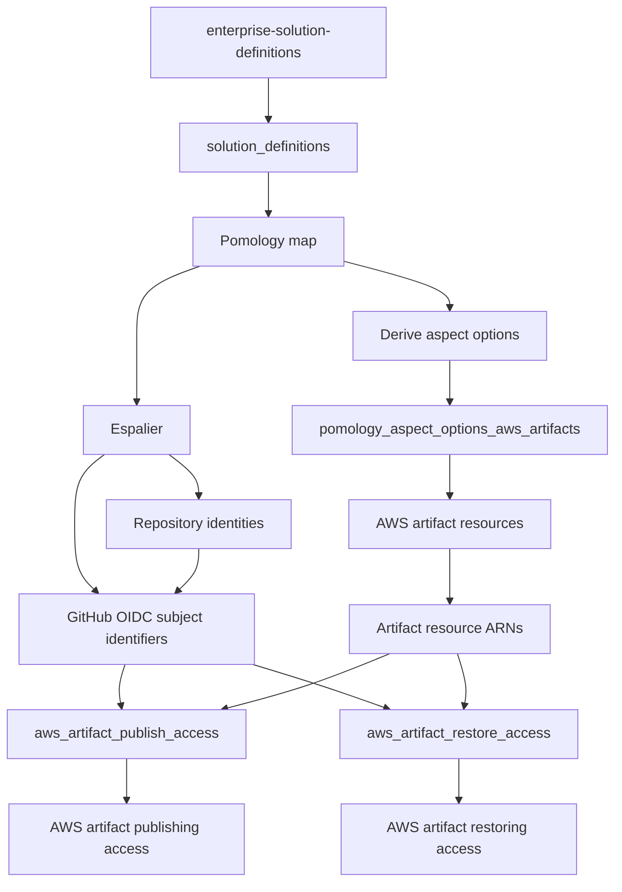
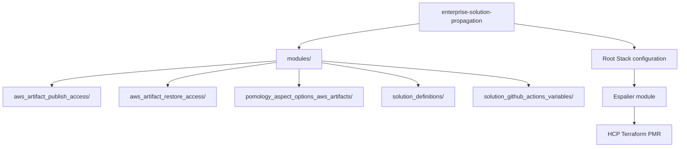

# Enterprise Solution Propagation

This repository contains the Terraform Stack configuration and supporting modules used to actualize Amiasea enterprise solution definitions.

The stack consumes released Pomology documents from [`amiasea/enterprise-solution-definitions`](https://github.com/amiasea/enterprise-solution-definitions), creates the corresponding GitHub repository structures through the Espalier module published in the HCP Terraform Private Module Registry (PMR), and provisions the AWS artifact infrastructure and access required by those solutions.

## Architecture

The propagation stack coordinates three areas:

1. **Solution definitions** — retrieves released Pomology documents that describe the intended repository hierarchy and aspect options for each solution.
2. **GitHub propagation** — invokes the PMR Espalier module to create the repositories and associated structures described by each Pomology.
3. **Artifact infrastructure and access** — provisions AWS ECR and CodeArtifact resources, then establishes GitHub Actions OIDC roles for publishing and restoring artifacts.

The stack operates across solutions using the solution names derived from the Pomology asset filenames.

## Stack components

### Espalier

The stack consumes the published Espalier module:

```hcl
component "espalier" {
  source  = "app.terraform.io/amiasea/espalier/github"
  version = "1.0.0"

  for_each = component.solution_definitions.pomologies

  inputs = {
    pomology         = each.value
    repo_name_prefix = each.key

    github_organization = "amiasea"
    github_app_id       = var.gha_id
  }
}
```

Each Pomology is passed to a separate Espalier component instance. The solution name becomes the repository name prefix.

Espalier is maintained and versioned independently of this repository. Its published PMR version is therefore an explicit dependency of the propagation stack.

### Supporting modules

The `modules/` directory contains the Terraform modules used by the stack:

| Module | Responsibility |
|---|---|
| `solution_definitions` | Retrieves Pomology JSON assets from a specified release of `amiasea/enterprise-solution-definitions`. |
| `pomology_aspect_options_aws_artifacts` | Creates AWS artifact repositories and packages for a solution's aspect options. |
| `aws_artifact_publish_access` | Creates an AWS IAM role and permissions for GitHub Actions to publish artifacts. |
| `aws_artifact_restore_access` | Creates an AWS IAM role and permissions for GitHub Actions to restore artifacts. |
| `solution_github_actions_variables` | Manages GitHub Actions variables associated with solutions. |

The Espalier module is not maintained in this repository. It is consumed from the PMR.

## Propagation flow

The stack follows this dependency flow:



### 1. Retrieve solution definitions

The `solution_definitions` module retrieves Pomology JSON assets from a specified release of the enterprise solution definitions repository.

Each asset is keyed by its solution name, derived from the asset filename by removing the `-pomology.json` suffix.

The resulting map drives the solution-level component instances in the stack.

### 2. Actualize GitHub repositories

The stack instantiates Espalier once for each Pomology.

Espalier creates the repository hierarchy and exposes repository identities, including repository names and IDs. The stack uses these outputs to derive:

- The aspect options represented by the solution's leaf repositories.
- GitHub OIDC subject identifiers for the cordon and leaf repositories.
- The GitHub repository IDs associated with the solution.

These derived values connect the GitHub repository structure to the AWS artifact access configuration.

### 3. Provision AWS artifact resources

For each solution, the `pomology_aspect_options_aws_artifacts` module provisions the AWS artifact resources associated with its aspect options.

The stack derives the distinct aspect options from the Espalier outputs and passes them to the module alongside the configured CodeArtifact domain.

### 4. Establish artifact publishing and restoring access

The stack creates separate IAM roles for publishing and restoring artifacts.

Both roles receive the solution's GitHub OIDC subject identifiers and the relevant AWS resource ARNs:

- CodeArtifact domain
- CodeArtifact repositories
- CodeArtifact packages
- ECR repositories

The separation provides distinct IAM roles for the two artifact workflows.

### 5. Configure GitHub Actions variables

The `solution_github_actions_variables` module provides the supporting capability for managing solution-level GitHub Actions variables.

## Configuration

The stack's configuration includes the following integration points:

| Configuration | Purpose |
|---|---|
| `pomology_flora_release_tag` | Selects the release of `amiasea/enterprise-solution-definitions` to consume. |
| `github_organization_name` | GitHub organization targeted by Espalier. |
| `gha_id` | GitHub App ID passed to Espalier. |
| `github_oidc_provider_arn` | AWS GitHub OIDC provider used by the artifact access roles. |
| `codeartifact_domain` | AWS CodeArtifact domain used for solution artifact resources. |
| `codeartifact_domain_arn` | ARN of the CodeArtifact domain used by the access roles. |

GitHub and AWS provider configurations and credentials must also be available to the stack and its components.

## Dependencies

The propagation stack depends on:

- The `amiasea/enterprise-solution-definitions` GitHub repository and its published Pomology releases.
- The Espalier module published to the Amiasea HCP Terraform Private Module Registry.
- A GitHub App with the permissions required to manage the target repositories.
- An AWS GitHub Actions OIDC provider.
- The AWS resources and permissions required to manage ECR, CodeArtifact, and IAM.

The Espalier module version is declared explicitly in the stack configuration. Updating that dependency is an intentional change to the repository propagation implementation.

## Repository structure



The root Stack configuration composes these supporting modules with the independently published Espalier module.